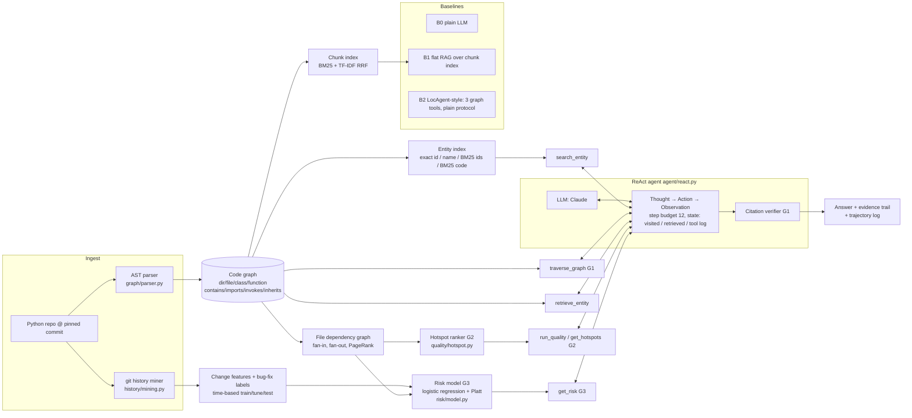

# Architecture

| Component | File | Gap | Switch (ablation) |
|---|---|---|---|
| Typed multi-hop traversal | `tools/graph_tools.py` | 1 | `A1_no_traverse`, `A2_hop1` |
| QA protocol prompt | `agent/react.py` (`QA_PROTOCOL`) | 1 | `A7_no_qa_prompt` |
| Citation verifier (one revision) | `agent/react.py` (`_verify`) | 1 | `A8_no_verifier` |
| RunQuality / GetHotspots + graph-aware hotspot score | `tools/quality_tools.py`, `quality/hotspot.py` | 2 | `A3_no_quality`; ranking without graph = `cc` |
| GetRisk, calibrated graph-aware risk model | `tools/quality_tools.py`, `risk/model.py` | 3 | `A3b_no_risk`; model variants `metrics` (no graph), `full_uncalibrated` |

All system configurations are declared in `agent/factory.py` (`SYSTEMS`).

**Robustness.** Tools are read-only and never raise into the loop (errors become observations). Invalid JSON
replies get a corrective observation. LLM/API errors are retried by the SDK (5 retries) and then recorded in the
trace; three consecutive errors end the run with an explicit message. When the step budget is spent the agent
is told to finish, and `budget_exhausted` is logged. Cited ids that never appeared in an observation are dropped
from the evidence and counted (`ungrounded`). All LLM calls are cached on disk, so a crashed experiment resumes
where it stopped, and re-running it reproduces the saved trajectories exactly.
